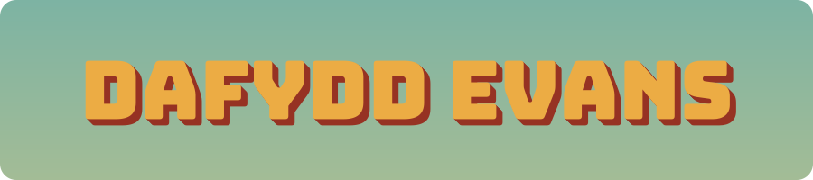

  

  

  

## 👋 About Me

MEng Engineering student at the University of Glasgow, 5th year.
I enjoy working across the stack, from low-level systems like compilers and VMs to higher-level software built around solid design patterns.
I like applying what I learn in one area to improve my work in another.

- 🎓 James Watt School of Engineering Excellence List, 2026
- 🗣️ Speaks Welsh and English
- 📫 Open to graduate software roles for 2027

## 🛠️ Tech Stack

  &nbsp;&nbsp;&nbsp;&nbsp;&nbsp;&nbsp;&nbsp;&nbsp;&nbsp;&nbsp;&nbsp;&nbsp;&nbsp;&nbsp;&nbsp;&nbsp;&nbsp;&nbsp;&nbsp;&nbsp;
  
  &nbsp;&nbsp;&nbsp;&nbsp;&nbsp;&nbsp;&nbsp;&nbsp;&nbsp;&nbsp;
  

## 🚀 Current Projects

- 🎓 **MEng Research Project:** developing a new machine learning model to simulate nano-bio transistors *(Python)*
- 📱 **Freelance App Development:** building two apps for independent clients *(ASP.NET)*

## 🧩 Recent Projects

- 🖥️ **Nand2Tetris:** built a full computer stack from the ground up, from logic gates to a VM translator and Jack compiler *(HDL, C++, Jack)*
- 🎣 **FiveM Mod Jam:** a Dredge-inspired fishing horror game mode for GTA V, built solo in 10 days *(C#)*
- 🎧 **Audio Converter:** a free tool that converts MP3 files to M4B audiobooks, so you can use chapters and adjust playback speed in book players *(Python)*

## 🐍 Contributions

